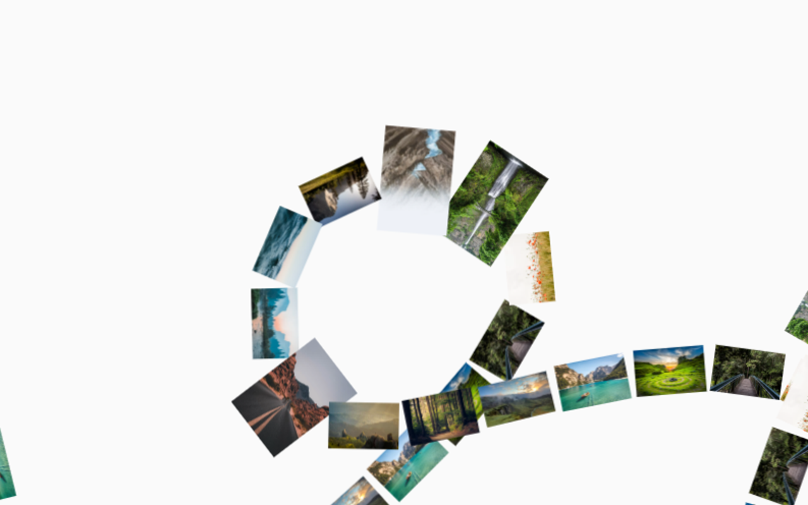
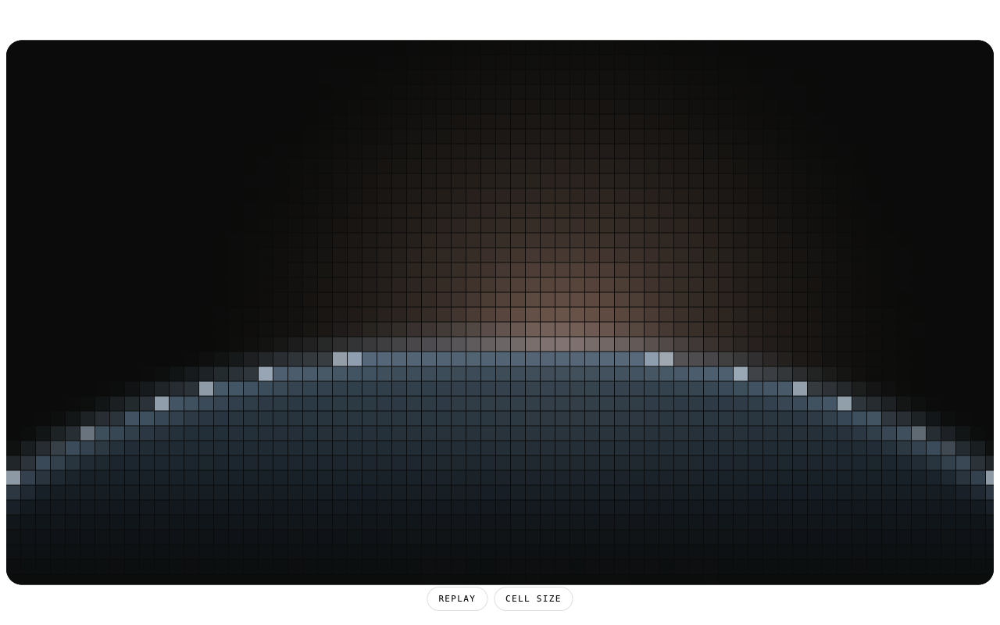
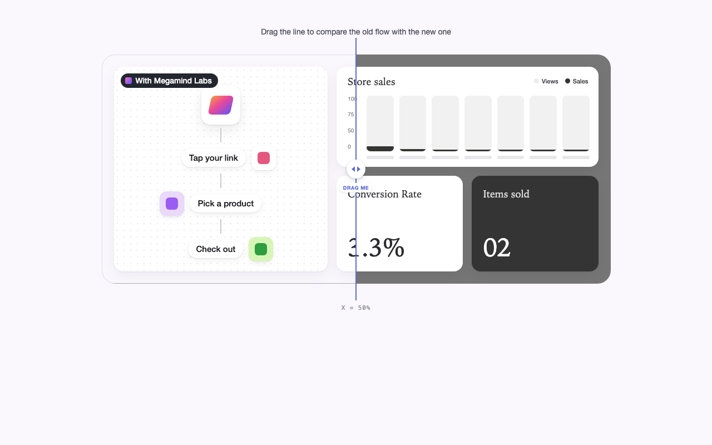
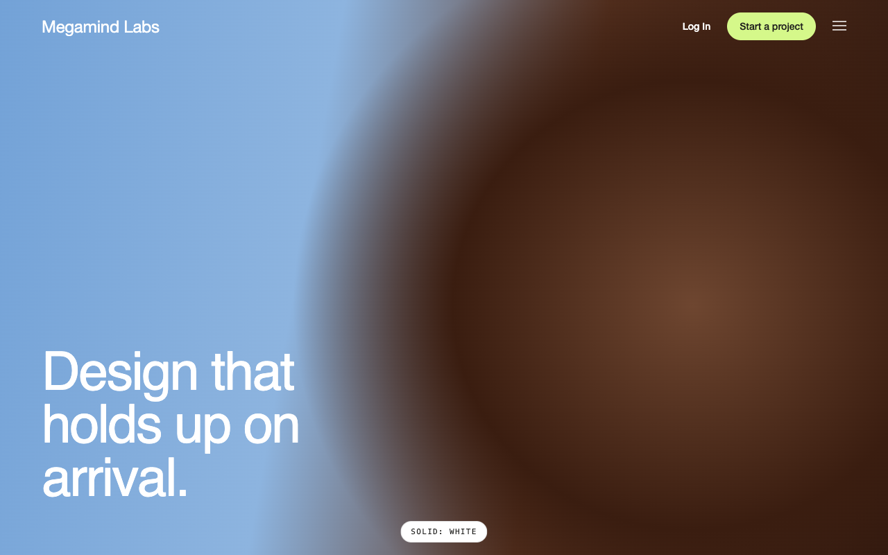
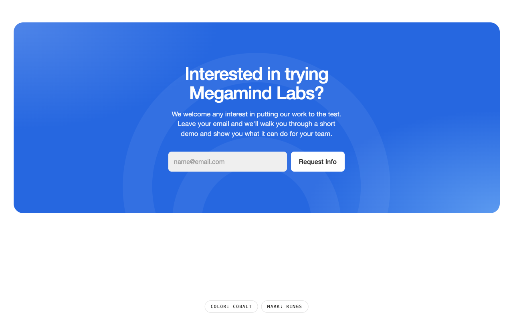
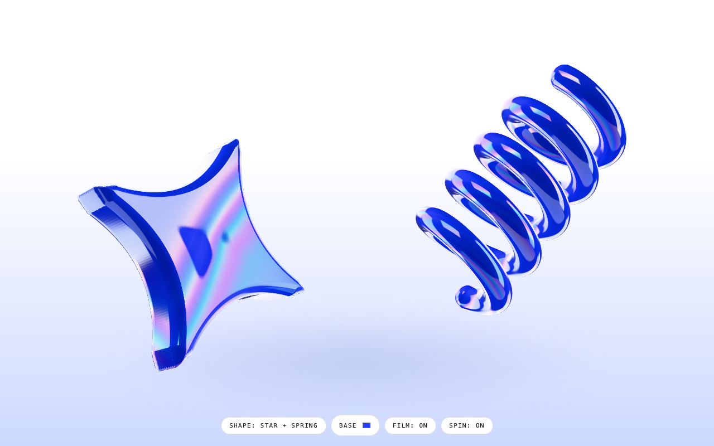
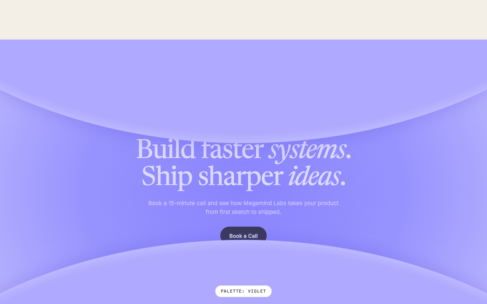
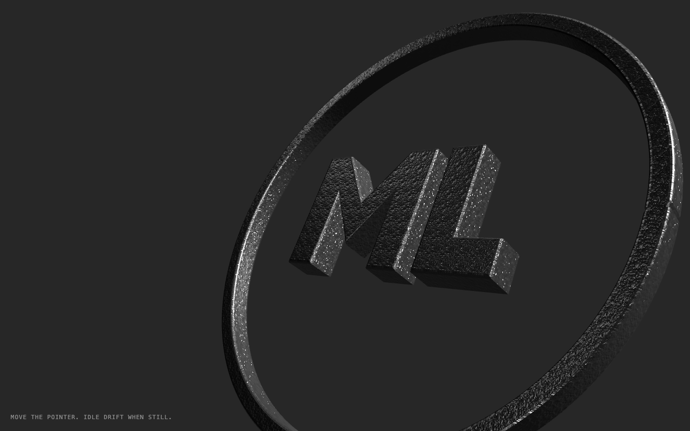
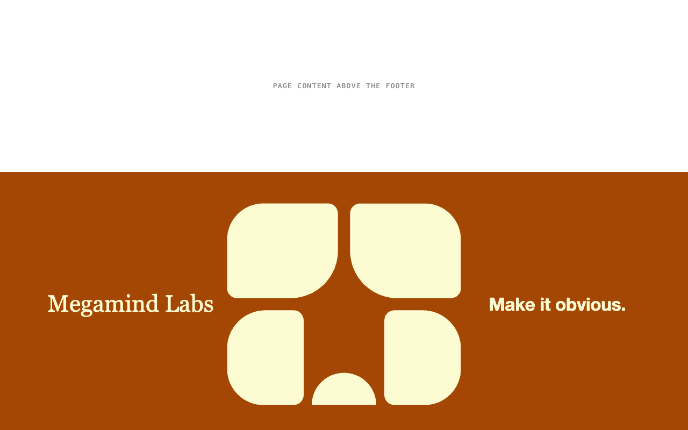

<h1 align="center">design-database</h1>

<p align="center">
  Interaction, motion and material studies for the web.<br>
  Small, self-contained components with live demos, documented props, and notes on how they work.
</p>

<p align="center">
  <a href="https://gitcamy.github.io/design-database/"><b>Browse the live gallery →</b></a>
</p>

<p align="center">
  
  
  
  
</p>

## What's here

Each one is a single effect: a cursor-lit ASCII wordmark, a marquee that follows any SVG path, a
cast-iron medallion that tilts on a damped spring, and more. Every component ships with:

- **The source**, ready to copy into a React (or plain Three.js) project
- **A `demo.html`** that runs with no build step
- **A README** listing every prop, plus the techniques that make it work

Click any preview to open its live demo.

<table>
<tr>
<td width="50%" valign="top"><b><a href="components/ascii-footer/">ascii-footer</a></b> · <a href="https://gitcamy.github.io/design-database/components/ascii-footer/demo.html">demo</a><br><sub>Footer that renders a wordmark as an ASCII glyph grid with a cursor-reactive point light. React + canvas.</sub></td>
<td width="50%" valign="top"><a href="https://gitcamy.github.io/design-database/components/marquee-along-svg-path/demo.html"></a><br><b><a href="components/marquee-along-svg-path/">marquee-along-svg-path</a></b><br><sub>Marquee that moves items along any SVG path, with drag, hover slowdown, and scroll coupling. React + TypeScript + Tailwind + motion.</sub></td>
</tr>
<tr>
<td width="50%" valign="top"><a href="https://gitcamy.github.io/design-database/components/mosaic-hero-open/demo.html"></a><br><b><a href="components/mosaic-hero-open/">mosaic-hero-open</a></b><br><sub>Hero that opens by expanding a pill to full bleed, with a screen-space tile mosaic that resolves as it grows. React + canvas.</sub></td>
<td width="50%" valign="top"><a href="https://gitcamy.github.io/design-database/components/before-after-drag-reveal/demo.html"></a><br><b><a href="components/before-after-drag-reveal/">before-after-drag-reveal</a></b><br><sub>Before/after comparison with a draggable divider that clips one layout over an identical one, cutting cards mid-way. React, no dependencies.</sub></td>
</tr>
<tr>
<td width="50%" valign="top"><a href="https://gitcamy.github.io/design-database/components/transparent-to-solid-nav/demo.html"></a><br><b><a href="components/transparent-to-solid-nav/">transparent-to-solid-nav</a></b><br><sub>Fixed nav that is transparent over the hero and switches to a solid white or colored bar on scroll. React, no dependencies.</sub></td>
<td width="50%" valign="top"><a href="https://gitcamy.github.io/design-database/components/watermark-cta-form/demo.html"></a><br><b><a href="components/watermark-cta-form/">watermark-cta-form</a></b><br><sub>CTA card with an inline email form, color-mixed corner glows, and a cropped low-opacity logo watermark. Color and mark are props. React, no dependencies.</sub></td>
</tr>
<tr>
<td width="50%" valign="top"><a href="https://gitcamy.github.io/design-database/components/iridescent-cobalt-3d/demo.html"></a><br><b><a href="components/iridescent-cobalt-3d/">iridescent-cobalt-3d</a></b><br><sub>Material for any 3D object: glossy cobalt plastic with a banded thin-film iridescent coat. Three.js module and demo, plus image-model and Blender prompts.</sub></td>
<td width="50%" valign="top"><a href="https://gitcamy.github.io/design-database/components/lens-part-cta-reveal/demo.html"></a><br><b><a href="components/lens-part-cta-reveal/">lens-part-cta-reveal</a></b><br><sub>Closing CTA revealed on scroll by two soft-lit ellipses that part like an opening lens, clipping and brightening the headline between them. React, no dependencies.</sub></td>
</tr>
<tr>
<td width="50%" valign="top"><a href="https://gitcamy.github.io/design-database/components/cast-iron-medallion-tilt/demo.html"></a><br><b><a href="components/cast-iron-medallion-tilt/">cast-iron-medallion-tilt</a></b><br><sub>3D ring-and-mark medallion in dark sandblasted cast iron that tilts toward the pointer on a critically damped spring. Three.js module and demo, plus image, video and code prompts.</sub></td>
<td width="50%" valign="top"><a href="https://gitcamy.github.io/design-database/components/negative-space-mark-footer/demo.html"></a><br><b><a href="components/negative-space-mark-footer/">negative-space-mark-footer</a></b><br><sub>Two-colour footer band with an oversized monogram whose gutters form a star in negative space. React + SVG.</sub></td>
</tr>
</table>

## Using a component

Copy the folder's component file into your project, then follow its README. To run a demo
locally, serve the repo over HTTP (some demos `fetch` their own source):

```bash
python3 -m http.server 8000
```

Then open `http://localhost:8000/components/<name>/demo.html`.

## How these are made

Most components start as a reference, such as a screen recording or a screenshot of an
interaction I liked. I break down the mechanic, measure its timings and palette, then rebuild it
from scratch as a reusable, prop-driven component. Brand, copy and imagery from the reference are
never carried over. Each README says what came from the reference and what didn't.

[`index.json`](index.json) is a machine-readable catalogue of everything here (tags, stack,
dependencies, file destinations, techniques), so tools and AI agents can search and install
components without walking the folders.

## Conventions

- One folder per component: `components/<name>/`.
- Include a `demo.html` that runs without a build step where practical.
- Document every exposed prop in the component's README.
- Add every component to `index.json` and to the preview grid above. `index.json`
  is the machine-readable catalogue — name, aliases, tags, stack,
  dependencies, file destinations, and the techniques worth reusing. Tools
  read it instead of walking the folders, so a component missing from it is
  effectively invisible.
- Add a 1280×800 preview to `docs/previews/<name>.png`.

## Credits

[marquee-along-svg-path](components/marquee-along-svg-path/) is
[MarqueeAlongSvgPath](https://github.com/danielpetho/fancy) from Daniel Petho's Fancy Components,
used under its MIT license. The setup notes, no-build demo and Framer port are mine.

## License

[MIT](LICENSE) © Cameron Gordon
